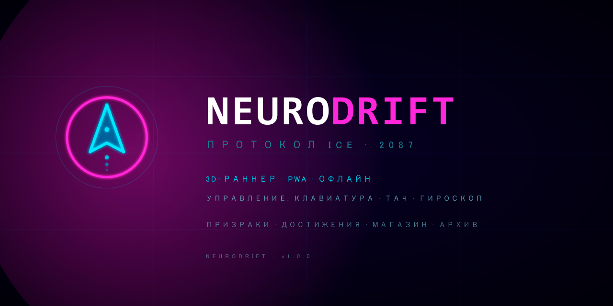

<div align="center">

# NEURODRIFT

**неоновый 3D-раннер в стиле киберпанк**

Лети сквозь стены ICE. Собирай осколки данных. Выживай в потоке.



[](https://web.dev/progressive-web-apps/)
[](https://threejs.org/)
[](LICENSE)
[](#)

[**▶ Играть**](https://dituals758.github.io/NEURODRIFT/)

</div>

---

## 📖 Лор

> **2087. Нео-Киото.**
>
> Корпорация **ARASHI** опутала город нейро-сетью. Каждые 47 часов ICE —
> Intrusion Countermeasure Electronics — усиливается. Стены реагируют
> не на данные. На **тебя**.
>
> Ты — дрифтер. Кодовое имя **PHASE-13**. Не хакер, не шпион — просто
> гонщик, вскрывший себе нейро-порт и подключивший дрон к потоку.
> Твоя задача не взломать ICE, а **пролететь сквозь него**.
>
> ICE дышит. Ты — его следующий вдох.

Полная хроника: [LORE.md](LORE.md)

---

## ✨ Возможности

- 🎮 **3 способа управления** — клавиатура, тач-зоны, гироскоп (с калибровкой)
- 🌌 **3D-туннель** с неоновой сеткой, туманом и glow-спрайтами
- 📈 **Бесконечные уровни** — скорость растёт до ~425 км/ч
- 🏆 **13 достижений** + локальный рекорд
- 🛒 **6 апгрейдов**, **3 скина** дрона
- 📖 **19 записей в Архиве (Кодексе)** — глоссарий лора в игре
- 👻 **Система призраков** — Тень (последний забег) и Фантом (лучший рекорд)
- 🌅 **Ежедневные забеги** — сид по дате, бейдж дня, daily streak
- 🎯 **Челлендж-ссылки** `?seed=N&target=X`
- 📤 **Share + экспорт/импорт** прогресса
- 📱 **PWA** — устанавливается, работает офлайн, баннер обновлений
- 🔋 **Wake Lock** — экран не гаснет в игре
- ⚡ **3 профиля качества** — Авто / Эконом / Максимум + адаптивный DPR
- ♿ **`prefers-reduced-motion`** — без тряски и вспышек
- 🎵 **Web Audio** — процедурная киберпанк-музыка (4 слоя) и 6+ SFX, ноль файлов
- 🌐 **Полностью русская локализация** (EN/JP — в планах)
- 🚫 **Ноль бэкенда, ноль трекеров, ноль cookie**

Размер: ~200 КБ HTML + 600 КБ three.js (gzip) + иконки.

---

## 🎯 Управление

| Платформа | Действие |
|-----------|----------|
| **Клавиатура** | `A`/`D` или `←`/`→` — влево/вправо |
| **Клавиатура** | `W`/`S` или `↑`/`↓` — вверх/вниз |
| **Тач** | Держи левую/правую половину экрана (X), стрелки справа (Y) |
| **Гироскоп** | Наклоняй устройство (кнопка в настройках) |
| **Пауза** | `Esc` / `P` / кнопка в HUD |

**Механика множителя:**
- Пролёт **впритирку** (< 1.2 юнита) → +1 к комбо
- Комбо живёт 3.5 сек
- Множитель = `1 + combo × 0.25` (макс **x8**)
- Редкий пурпурный осколок → **x3** к очкам
- **Идеальный проход** через центр → **x2** к бонусу near-miss

---

## 🏆 Достижения

| # | Название | Условие |
|---|----------|---------|
| 1 | ПЕРВЫЙ ВЗЛОМ | 1 000 нейро-битов |
| 2 | ПРИЗРАК В СЕТИ | Множитель x6 |
| 3 | СКОЛЬЖЕНИЕ | 60 секунд в потоке |
| 4 | ЧИСТЫЙ ПРОХОД | 5 000 NB без единого попадания |
| 5 | ГЛУБОКО В СЕТИ | 10 уровень |
| 6 | КОЛЛЕКЦИОНЕР | 25 осколков за забег |
| 7 | БЕЗ РУК | 2 000 NB управляя гироскопом |
| 8 | ДРИФТЕР | 15 000 NB |
| 9 | ЛЕГЕНДА НЕЙРОДРИФТА | 30 000 NB |
| 10 | ВЕТЕРАН ПОТОКА | 25 забегов |
| 11 | ИДЕАЛЬНЫЙ ПРОХОД | 10 идеальных проходов за забег |
| 12 | ЕЖЕДНЕВНЫЙ | Ежедневный забег 7 дней подряд |
| 13 | БЕЗ ЕДИНОГО КАСАНИЯ | 20 000 NB без попаданий |

---

## 🎯 Челленджи

Брось вызов другу — отправь ссылку на конкретный забег:

```text
https://dituals758.github.io/NEURODRIFT/?seed=12345&target=15000
seed — число, определяющее поток препятствий (одинаковый у всех)

target — цель по очкам

При открытии игрок видит: «ЦЕЛЬ: 15 000». После забега — «✓ ЦЕЛЬ ДОСТИГНУТА» или «✗ ЦЕЛЬ УПУЩЕНА».

Ежедневный забег: https://dituals758.github.io/NEURODRIFT/?daily=1 (или через ярлык на иконке PWA).

📤 Экспорт / Импорт
В меню → «ПРОГРЕСС»:

ЭКСПОРТ — сохранить прогресс в JSON (через navigator.share на iOS/mobile)

ИМПОРТ — загрузить из JSON-файла

Формат совместим между устройствами.

🛠 Технологии
Three.js 0.160 — 3D-рендер

Vanilla JS — ноль фреймворков, ноль сборки

Web Audio API — процедурная музыка и SFX

Service Worker + Cache API — офлайн

Wake Lock API — блокировка сна экрана

DeviceOrientation API — гироскоп

localStorage — прогресс (без бэкенда)

📦 Локальный запуск
bash
git clone https://github.com/dituals758/NEURODRIFT.git
cd NEURODRIFT
python3 -m http.server 8080
⚠️ Service Worker работает только на HTTPS или localhost.

🚀 Деплой
GitHub Pages / Cloudflare Pages / Netlify / Vercel — drag-and-drop, билд не нужен. Текущий деплой: GitHub Pages → https://dituals758.github.io/NEURODRIFT/.

🔄 Обновления PWA
Версия в одном месте — sw.js:

js
const VERSION = 'v2.0.2';
При следующем визите — баннер «ДОСТУПНО ОБНОВЛЕНИЕ». Старый кеш удаляется автоматически.

Bump VERSION обязателен при:

любом изменении index.html (даже опечатка)

любом изменении sw.js (кеш-стратегия, ASSETS)

изменении manifest.json

изменении иконок / splash / social

Иначе пользователи застрянут на старой версии до ручной очистки Safari.

🧪 Тестирование
Chrome DevTools:

Application → Manifest / Service Workers

Lighthouse → PWA (цель: 100)

Lighthouse → Performance (цель: ≥ 90 mobile)

Обязательно на iPhone Safari:

□ Установка через «Поделиться → На экран Домой»
□ Standalone без адресной строки
□ Гироскоп запрашивает разрешение
□ Оффлайн (Авиарежим) — игра запускается
□ Wake Lock держит экран
□ Dynamic Island не перекрывает HUD
□ Landscape → корректная вёрстка
🗺 Roadmap
☑ v1.0.0 — базовый раннер, PWA

☑ v1.1.0 — честные разрывы, редкие осколки, тосты

☑ v1.2.0 — фикс коллизий, near-miss, оптимизация, профили качества, экспорт/импорт, share, кодекс, About, челлендж-ссылки

☑ v2.0.0 — ежедневные забеги, идеальные проходы, процедурная музыка, призраки, 13 достижений, 6 апгрейдов, 3 скина, 19 записей Архива

☑ v2.0.2 — замена заглушек, LICENSE, CHANGELOG, THIRD_PARTY_LICENSES, LORE.md

□ v2.1 — полировка, релиз, itch.io, pwa.directory

□ v2.2 — контент: streak-бейдж, рекорд друга, weekly stats, speedrun, ghost video

□ v2.3 — соцфункции: leaderboard (Cloudflare Workers), челлендж-ссылки с призраком, share-картинка, виджет

□ v3.0 — процедурная музыка v2, скины туннеля, ghost multiplayer (WebRTC), боссы, EN/JP-локализация

🤝 Contributing
PR welcome. Bug reports → Issues.

📄 Лицензия
MIT

Сторонние библиотеки
Three.js — MIT, © 2010-2026 three.js authors

Полный текст: THIRD_PARTY_LICENSES.txt

<div align="center"> <sub>NEURODRIFT · протокол ICE · 2087</sub><br> <sub>ICE дышит.</sub> </div> ```